### Hi, I'm Valentin 👋

Full-stack developer and **AI integrator**, working mostly in **TypeScript** — Node.js services and
APIs on the back end, Vue 3 on the front, and LLM pipelines wired into products rather than bolted
on afterwards: embeddings and deduplication, classification, rewriting and translation, with the
orchestration and the guardrails around them.

In open source I work across the Vue toolchain, layer by layer — the renderer (`vuejs/core`,
mostly **Vapor mode**), the linter (`eslint-plugin-vue`), the type tooling (`language-tools`) and
the test layer (`test-utils`). <!--m:total-->244<!--/m:total--> merged PRs so far.

```yaml
name: "Valentin Youshkevich"
handle: ValentinYoushkevich
focus:
  - "Full-stack TypeScript — Node.js, Fastify, Express, Prisma / PostgreSQL"
  - "Vue 3 · Vite · Tailwind on the client"
  - "AI integrations — LLM pipelines, embeddings, local and hosted models"
open_source: "Vue ecosystem — core (Vapor mode), eslint-plugin-vue, test-utils, language-tools"
house_rules:
  - "A failing test before the fix, always"
  - "Smallest sufficient change — no drive-by cleanup"
  - "If it claims a perf win, it ships with numbers"
```

---

### 🟢 Open source

<!--m:summary-->
**Merged** — 244 PRs: 124 in `vuejs/core` · 71 in `eslint-plugin-vue` · 23 in `test-utils` · 17 in `reka-ui` · 3 in `language-tools` · 2 in `vuetify` · 1 in `eslint` · 1 in `typescript-eslint` · 1 in `devtools` · 1 in `knip`
<!--/m:summary-->

In [`vuejs/core`](https://github.com/vuejs/core/pulls?q=is%3Apr+author%3AValentinYoushkevich+is%3Amerged) — <!--m:count-->124<!--/m:count--> merged pull requests, mostly in Vapor mode:

| Area | What I fixed | PRs |
|---|---|---|
| `runtime-vapor` — interop: slots | Slots crossing the Vapor ↔ VDOM boundary: fallthrough attrs, directives and `cloneVNode` extras now reach the slot content; empty, multi-root and forwarded slot content, outlets rooted in a VDOM child and slots of VDOM async components mount where VDOM puts them; CSS vars apply to a Vapor slot rendered in VDOM | [#16265](https://github.com/vuejs/core/pull/16265), [#16261](https://github.com/vuejs/core/pull/16261), [#16256](https://github.com/vuejs/core/pull/16256), [#16255](https://github.com/vuejs/core/pull/16255), [#16219](https://github.com/vuejs/core/pull/16219), [#16096](https://github.com/vuejs/core/pull/16096), [#15754](https://github.com/vuejs/core/pull/15754), [#15747](https://github.com/vuejs/core/pull/15747), [#15719](https://github.com/vuejs/core/pull/15719), [#15575](https://github.com/vuejs/core/pull/15575), [#15542](https://github.com/vuejs/core/pull/15542), [#15513](https://github.com/vuejs/core/pull/15513) |
| `runtime-vapor` — interop: components | Mixed Vapor/VDOM trees: a VDOM root replaced by a nested update, VDOM roots unmounted with their owner, components patched instead of remounted in teleports and dynamic components; template refs and plain-object props reach VDOM components; `$el`, emits options and other instance properties work on exposed Vapor instances | [#16283](https://github.com/vuejs/core/pull/16283), [#16217](https://github.com/vuejs/core/pull/16217), [#15738](https://github.com/vuejs/core/pull/15738), [#15733](https://github.com/vuejs/core/pull/15733), [#15706](https://github.com/vuejs/core/pull/15706), [#15705](https://github.com/vuejs/core/pull/15705), [#15669](https://github.com/vuejs/core/pull/15669), [#15664](https://github.com/vuejs/core/pull/15664), [#15631](https://github.com/vuejs/core/pull/15631), [#15624](https://github.com/vuejs/core/pull/15624), [#15524](https://github.com/vuejs/core/pull/15524) |
| `runtime-vapor` — Transition & KeepAlive | out-in and in-out handoffs between branches; Transition attrs through slot outlets; class updates no longer wipe transition classes; KeepAlive kept stale props, never unmounted a reactivated component, dropped the current branch on an `include`/`exclude` change and resumed the wrong `v-else-if` branch | [#16281](https://github.com/vuejs/core/pull/16281), [#16264](https://github.com/vuejs/core/pull/16264), [#15665](https://github.com/vuejs/core/pull/15665), [#15655](https://github.com/vuejs/core/pull/15655), [#15654](https://github.com/vuejs/core/pull/15654), [#15583](https://github.com/vuejs/core/pull/15583), [#15560](https://github.com/vuejs/core/pull/15560), [#15528](https://github.com/vuejs/core/pull/15528), [#15526](https://github.com/vuejs/core/pull/15526), [#15525](https://github.com/vuejs/core/pull/15525) |
| `runtime-vapor` — hydration | Multi-root async components desynced the walk; empty text, empty branches and empty slot ranges hydrated out of place; text line breaks were not normalized; a `null` value binding crashed; CSS vars of a VDOM parent and the suspense boundary are passed through; hydration lookups are tree-shaken from client bundles | [#16073](https://github.com/vuejs/core/pull/16073), [#15906](https://github.com/vuejs/core/pull/15906), [#15875](https://github.com/vuejs/core/pull/15875), [#15721](https://github.com/vuejs/core/pull/15721), [#15720](https://github.com/vuejs/core/pull/15720), [#15713](https://github.com/vuejs/core/pull/15713), [#15707](https://github.com/vuejs/core/pull/15707), [#15667](https://github.com/vuejs/core/pull/15667), [#15541](https://github.com/vuejs/core/pull/15541), [#15534](https://github.com/vuejs/core/pull/15534), [#15532](https://github.com/vuejs/core/pull/15532) |
| `runtime-vapor` — rendering | `v-for` order around empty branches and keyed inserts, refs in a `v-for` source, invalid ranges; radio `v-model`, symbol input values, `checked` / `selected` mirrored to attributes; SVG and MathML dynamic roots, custom elements, scope ids on native slot outlets, refs to exposed values, deferred teleport hooks and empty dynamic components | [#16216](https://github.com/vuejs/core/pull/16216), [#16094](https://github.com/vuejs/core/pull/16094), [#15991](https://github.com/vuejs/core/pull/15991), [#15909](https://github.com/vuejs/core/pull/15909), [#15863](https://github.com/vuejs/core/pull/15863), [#15830](https://github.com/vuejs/core/pull/15830), [#15797](https://github.com/vuejs/core/pull/15797), [#15636](https://github.com/vuejs/core/pull/15636), [#15601](https://github.com/vuejs/core/pull/15601), [#15594](https://github.com/vuejs/core/pull/15594), [#15529](https://github.com/vuejs/core/pull/15529), [#15527](https://github.com/vuejs/core/pull/15527), [#15522](https://github.com/vuejs/core/pull/15522), [#15520](https://github.com/vuejs/core/pull/15520) |
| `runtime-vapor` — component instance | Props are shallow and skip reserved keys; `hasOwnProperty` on props, attrs and slots; fallthrough attrs merged only when present; `$props` / `$attrs` / `$slots` in CSS `v-bind`; `<style module>` bindings; the error component of an async wrapper gets its props; a dev-only parent leak, missing warning context and a warning for components made reactive; render timing measures only the outermost run | [#16257](https://github.com/vuejs/core/pull/16257), [#16095](https://github.com/vuejs/core/pull/16095), [#15993](https://github.com/vuejs/core/pull/15993), [#15969](https://github.com/vuejs/core/pull/15969), [#15874](https://github.com/vuejs/core/pull/15874), [#15841](https://github.com/vuejs/core/pull/15841), [#15835](https://github.com/vuejs/core/pull/15835), [#15739](https://github.com/vuejs/core/pull/15739), [#15647](https://github.com/vuejs/core/pull/15647), [#15621](https://github.com/vuejs/core/pull/15621), [#15506](https://github.com/vuejs/core/pull/15506), [#15497](https://github.com/vuejs/core/pull/15497) |
| `compiler-vapor` — expressions | Repeated expressions replaced only at exact AST ranges; unsafe caching of optional chains, unsupported member keys and nested members; `_ctx` shadowing, digit-leading names, setup bindings that shadow globals, destructured aliases, `v-for` aliases and same-name keys, `await` in module mode, `new` with `unref`, TS-wrapped `v-model` targets and empty directive expressions | [#15834](https://github.com/vuejs/core/pull/15834), [#15828](https://github.com/vuejs/core/pull/15828), [#15826](https://github.com/vuejs/core/pull/15826), [#15813](https://github.com/vuejs/core/pull/15813), [#15808](https://github.com/vuejs/core/pull/15808), [#15771](https://github.com/vuejs/core/pull/15771), [#15763](https://github.com/vuejs/core/pull/15763), [#15751](https://github.com/vuejs/core/pull/15751), [#15744](https://github.com/vuejs/core/pull/15744), [#15709](https://github.com/vuejs/core/pull/15709), [#15666](https://github.com/vuejs/core/pull/15666), [#15552](https://github.com/vuejs/core/pull/15552), [#15540](https://github.com/vuejs/core/pull/15540), [#15538](https://github.com/vuejs/core/pull/15538), [#15530](https://github.com/vuejs/core/pull/15530) |
| `compiler-vapor` — output parity | Output that matches VDOM: raw `v-model` values, number literals on slot outlet props, the leading newline of `<pre>` / `<textarea>`, attributes and comments decoded once, nullish dynamic arguments dropped, static style passed as an object, `.prop` / `.attr` kept, input `value` set last, end tags kept in nested lists and at foreign scopes, whitespace between `v-if` branches dropped, constants folded only when the template can carry them | [#16259](https://github.com/vuejs/core/pull/16259), [#16097](https://github.com/vuejs/core/pull/16097), [#15831](https://github.com/vuejs/core/pull/15831), [#15799](https://github.com/vuejs/core/pull/15799), [#15796](https://github.com/vuejs/core/pull/15796), [#15745](https://github.com/vuejs/core/pull/15745), [#15722](https://github.com/vuejs/core/pull/15722), [#15698](https://github.com/vuejs/core/pull/15698), [#15657](https://github.com/vuejs/core/pull/15657), [#15656](https://github.com/vuejs/core/pull/15656), [#15646](https://github.com/vuejs/core/pull/15646), [#15620](https://github.com/vuejs/core/pull/15620), [#15606](https://github.com/vuejs/core/pull/15606), [#15587](https://github.com/vuejs/core/pull/15587), [#15574](https://github.com/vuejs/core/pull/15574), [#15563](https://github.com/vuejs/core/pull/15563), [#15553](https://github.com/vuejs/core/pull/15553), [#15550](https://github.com/vuejs/core/pull/15550), [#15543](https://github.com/vuejs/core/pull/15543), [#15539](https://github.com/vuejs/core/pull/15539), [#15511](https://github.com/vuejs/core/pull/15511), [#15510](https://github.com/vuejs/core/pull/15510) |
| `compiler-vapor` — slots, keys & diagnostics | `key` ignored on `<template>` branches and slots; conditional slots override unconditional ones; parent slots isolated for a plain `<template>`; errors for shared `v-if` keys and for `v-model` on consts and scope variables; a warning for ignored `@vue:*` hooks | [#15810](https://github.com/vuejs/core/pull/15810), [#15807](https://github.com/vuejs/core/pull/15807), [#15779](https://github.com/vuejs/core/pull/15779), [#15772](https://github.com/vuejs/core/pull/15772), [#15714](https://github.com/vuejs/core/pull/15714), [#15588](https://github.com/vuejs/core/pull/15588), [#15514](https://github.com/vuejs/core/pull/15514), [#15509](https://github.com/vuejs/core/pull/15509) |
| `runtime-core` · `runtime-dom` · `reactivity` | A computed invalidated by its own run no longer notifies its readers; async components regained the default 200 ms loading delay; invalid `v-for` ranges render nothing in production; `disablepictureinpicture` / `disableremoteplayback` are boolean attributes; injected CSS vars survive a nullish style binding | [#16220](https://github.com/vuejs/core/pull/16220), [#15952](https://github.com/vuejs/core/pull/15952), [#15950](https://github.com/vuejs/core/pull/15950), [#15742](https://github.com/vuejs/core/pull/15742), [#15623](https://github.com/vuejs/core/pull/15623) |

<details>
<summary>Merged pull requests in other projects</summary>

<!--m:unlisted-->
<sub>[#16453](https://github.com/vuejs/core/pull/16453), [#16429](https://github.com/vuejs/core/pull/16429), [#16428](https://github.com/vuejs/core/pull/16428), [#16352](https://github.com/vuejs/core/pull/16352) in `vuejs/core`, plus [vuetify#23434](https://github.com/vuetifyjs/vuetify/pull/23434), [knip#2470](https://github.com/webpro-nl/knip/pull/2470), [vuetify#23430](https://github.com/vuetifyjs/vuetify/pull/23430), [reka-ui#3353](https://github.com/unovue/reka-ui/pull/3353), [reka-ui#3352](https://github.com/unovue/reka-ui/pull/3352), [reka-ui#3350](https://github.com/unovue/reka-ui/pull/3350), [reka-ui#3349](https://github.com/unovue/reka-ui/pull/3349), [reka-ui#3348](https://github.com/unovue/reka-ui/pull/3348), [reka-ui#3347](https://github.com/unovue/reka-ui/pull/3347), [reka-ui#3346](https://github.com/unovue/reka-ui/pull/3346), [reka-ui#3345](https://github.com/unovue/reka-ui/pull/3345), [reka-ui#3343](https://github.com/unovue/reka-ui/pull/3343), [reka-ui#3342](https://github.com/unovue/reka-ui/pull/3342), [reka-ui#3341](https://github.com/unovue/reka-ui/pull/3341), [reka-ui#3340](https://github.com/unovue/reka-ui/pull/3340), [reka-ui#3339](https://github.com/unovue/reka-ui/pull/3339), [test-utils#3044](https://github.com/vuejs/test-utils/pull/3044), [test-utils#3043](https://github.com/vuejs/test-utils/pull/3043), [test-utils#3042](https://github.com/vuejs/test-utils/pull/3042), [test-utils#3041](https://github.com/vuejs/test-utils/pull/3041), [reka-ui#3286](https://github.com/unovue/reka-ui/pull/3286), [reka-ui#3285](https://github.com/unovue/reka-ui/pull/3285), [reka-ui#3284](https://github.com/unovue/reka-ui/pull/3284), [reka-ui#3283](https://github.com/unovue/reka-ui/pull/3283), [eslint-plugin-vue#3264](https://github.com/vuejs/eslint-plugin-vue/pull/3264), [eslint-plugin-vue#3263](https://github.com/vuejs/eslint-plugin-vue/pull/3263), [eslint-plugin-vue#3261](https://github.com/vuejs/eslint-plugin-vue/pull/3261), [eslint-plugin-vue#3260](https://github.com/vuejs/eslint-plugin-vue/pull/3260), [test-utils#3035](https://github.com/vuejs/test-utils/pull/3035), [test-utils#3033](https://github.com/vuejs/test-utils/pull/3033), [test-utils#3032](https://github.com/vuejs/test-utils/pull/3032), [test-utils#3031](https://github.com/vuejs/test-utils/pull/3031), [eslint-plugin-vue#3257](https://github.com/vuejs/eslint-plugin-vue/pull/3257), [devtools#1192](https://github.com/vuejs/devtools/pull/1192), [test-utils#3030](https://github.com/vuejs/test-utils/pull/3030), [eslint-plugin-vue#3251](https://github.com/vuejs/eslint-plugin-vue/pull/3251), [test-utils#3014](https://github.com/vuejs/test-utils/pull/3014), [test-utils#3013](https://github.com/vuejs/test-utils/pull/3013), [eslint-plugin-vue#3238](https://github.com/vuejs/eslint-plugin-vue/pull/3238), [eslint-plugin-vue#3237](https://github.com/vuejs/eslint-plugin-vue/pull/3237), [test-utils#2998](https://github.com/vuejs/test-utils/pull/2998), [test-utils#2997](https://github.com/vuejs/test-utils/pull/2997), [eslint-plugin-vue#3236](https://github.com/vuejs/eslint-plugin-vue/pull/3236), [eslint#21464](https://github.com/eslint/eslint/pull/21464), [test-utils#2996](https://github.com/vuejs/test-utils/pull/2996), [eslint-plugin-vue#3234](https://github.com/vuejs/eslint-plugin-vue/pull/3234), [eslint-plugin-vue#3228](https://github.com/vuejs/eslint-plugin-vue/pull/3228), [test-utils#2993](https://github.com/vuejs/test-utils/pull/2993), [eslint-plugin-vue#3227](https://github.com/vuejs/eslint-plugin-vue/pull/3227), [eslint-plugin-vue#3219](https://github.com/vuejs/eslint-plugin-vue/pull/3219), [eslint-plugin-vue#3217](https://github.com/vuejs/eslint-plugin-vue/pull/3217), [eslint-plugin-vue#3209](https://github.com/vuejs/eslint-plugin-vue/pull/3209), [eslint-plugin-vue#3208](https://github.com/vuejs/eslint-plugin-vue/pull/3208), [eslint-plugin-vue#3207](https://github.com/vuejs/eslint-plugin-vue/pull/3207), [eslint-plugin-vue#3206](https://github.com/vuejs/eslint-plugin-vue/pull/3206), [eslint-plugin-vue#3202](https://github.com/vuejs/eslint-plugin-vue/pull/3202), [test-utils#2978](https://github.com/vuejs/test-utils/pull/2978), [eslint-plugin-vue#3201](https://github.com/vuejs/eslint-plugin-vue/pull/3201), [test-utils#2977](https://github.com/vuejs/test-utils/pull/2977), [eslint-plugin-vue#3200](https://github.com/vuejs/eslint-plugin-vue/pull/3200), [eslint-plugin-vue#3199](https://github.com/vuejs/eslint-plugin-vue/pull/3199), [eslint-plugin-vue#3198](https://github.com/vuejs/eslint-plugin-vue/pull/3198), [test-utils#2975](https://github.com/vuejs/test-utils/pull/2975), [eslint-plugin-vue#3197](https://github.com/vuejs/eslint-plugin-vue/pull/3197), [test-utils#2974](https://github.com/vuejs/test-utils/pull/2974), [eslint-plugin-vue#3196](https://github.com/vuejs/eslint-plugin-vue/pull/3196), [eslint-plugin-vue#3191](https://github.com/vuejs/eslint-plugin-vue/pull/3191), [eslint-plugin-vue#3190](https://github.com/vuejs/eslint-plugin-vue/pull/3190), [eslint-plugin-vue#3189](https://github.com/vuejs/eslint-plugin-vue/pull/3189), [eslint-plugin-vue#3188](https://github.com/vuejs/eslint-plugin-vue/pull/3188), [eslint-plugin-vue#3187](https://github.com/vuejs/eslint-plugin-vue/pull/3187), [eslint-plugin-vue#3186](https://github.com/vuejs/eslint-plugin-vue/pull/3186), [eslint-plugin-vue#3185](https://github.com/vuejs/eslint-plugin-vue/pull/3185), [language-tools#6275](https://github.com/vuejs/language-tools/pull/6275), [eslint-plugin-vue#3184](https://github.com/vuejs/eslint-plugin-vue/pull/3184), [eslint-plugin-vue#3183](https://github.com/vuejs/eslint-plugin-vue/pull/3183), [eslint-plugin-vue#3181](https://github.com/vuejs/eslint-plugin-vue/pull/3181), [eslint-plugin-vue#3180](https://github.com/vuejs/eslint-plugin-vue/pull/3180), [eslint-plugin-vue#3179](https://github.com/vuejs/eslint-plugin-vue/pull/3179), [eslint-plugin-vue#3178](https://github.com/vuejs/eslint-plugin-vue/pull/3178), [eslint-plugin-vue#3177](https://github.com/vuejs/eslint-plugin-vue/pull/3177), [eslint-plugin-vue#3174](https://github.com/vuejs/eslint-plugin-vue/pull/3174), [eslint-plugin-vue#3173](https://github.com/vuejs/eslint-plugin-vue/pull/3173), [eslint-plugin-vue#3169](https://github.com/vuejs/eslint-plugin-vue/pull/3169), [eslint-plugin-vue#3165](https://github.com/vuejs/eslint-plugin-vue/pull/3165), [eslint-plugin-vue#3164](https://github.com/vuejs/eslint-plugin-vue/pull/3164), [test-utils#2971](https://github.com/vuejs/test-utils/pull/2971), [eslint-plugin-vue#3163](https://github.com/vuejs/eslint-plugin-vue/pull/3163), [eslint-plugin-vue#3162](https://github.com/vuejs/eslint-plugin-vue/pull/3162), [eslint-plugin-vue#3161](https://github.com/vuejs/eslint-plugin-vue/pull/3161), [eslint-plugin-vue#3160](https://github.com/vuejs/eslint-plugin-vue/pull/3160), [eslint-plugin-vue#3159](https://github.com/vuejs/eslint-plugin-vue/pull/3159), [eslint-plugin-vue#3158](https://github.com/vuejs/eslint-plugin-vue/pull/3158), [eslint-plugin-vue#3157](https://github.com/vuejs/eslint-plugin-vue/pull/3157), [test-utils#2965](https://github.com/vuejs/test-utils/pull/2965), [test-utils#2963](https://github.com/vuejs/test-utils/pull/2963), [eslint-plugin-vue#3155](https://github.com/vuejs/eslint-plugin-vue/pull/3155), [eslint-plugin-vue#3154](https://github.com/vuejs/eslint-plugin-vue/pull/3154), [eslint-plugin-vue#3151](https://github.com/vuejs/eslint-plugin-vue/pull/3151), [eslint-plugin-vue#3150](https://github.com/vuejs/eslint-plugin-vue/pull/3150), [test-utils#2957](https://github.com/vuejs/test-utils/pull/2957), [language-tools#6232](https://github.com/vuejs/language-tools/pull/6232), [language-tools#6214](https://github.com/vuejs/language-tools/pull/6214), [eslint-plugin-vue#3146](https://github.com/vuejs/eslint-plugin-vue/pull/3146), [eslint-plugin-vue#3145](https://github.com/vuejs/eslint-plugin-vue/pull/3145), [eslint-plugin-vue#3144](https://github.com/vuejs/eslint-plugin-vue/pull/3144), [eslint-plugin-vue#3143](https://github.com/vuejs/eslint-plugin-vue/pull/3143), [eslint-plugin-vue#3142](https://github.com/vuejs/eslint-plugin-vue/pull/3142), [eslint-plugin-vue#3141](https://github.com/vuejs/eslint-plugin-vue/pull/3141), [eslint-plugin-vue#3125](https://github.com/vuejs/eslint-plugin-vue/pull/3125), [eslint-plugin-vue#3124](https://github.com/vuejs/eslint-plugin-vue/pull/3124), [eslint-plugin-vue#3123](https://github.com/vuejs/eslint-plugin-vue/pull/3123), [eslint-plugin-vue#3122](https://github.com/vuejs/eslint-plugin-vue/pull/3122), [typescript-eslint#12697](https://github.com/typescript-eslint/typescript-eslint/pull/12697), [eslint-plugin-vue#3119](https://github.com/vuejs/eslint-plugin-vue/pull/3119), [eslint-plugin-vue#3118](https://github.com/vuejs/eslint-plugin-vue/pull/3118), [eslint-plugin-vue#3116](https://github.com/vuejs/eslint-plugin-vue/pull/3116), [eslint-plugin-vue#3115](https://github.com/vuejs/eslint-plugin-vue/pull/3115), [eslint-plugin-vue#3114](https://github.com/vuejs/eslint-plugin-vue/pull/3114) and [eslint-plugin-vue#3113](https://github.com/vuejs/eslint-plugin-vue/pull/3113).</sub>
<!--/m:unlisted-->

</details>

---

### 🚀 Selected work

| Project | What it is | Stack |
|---|---|---|
| [**clever-vibe**](https://github.com/ValentinYoushkevich/clever-vibe) | Tracks where AI assistants actually help in development: each use is logged in 20–30 seconds against a catalogue of ~41 approaches, scored for usefulness and trust, and rolled up into frequency × usefulness quadrants, stage coverage and per-approach spread — with averages muted below N = 5. | TypeScript · Fastify · Prisma/PostgreSQL · Vue 3 · PrimeVue · Vitest · Docker |
| [**news-poster**](https://github.com/ValentinYoushkevich/news-poster) | News pipeline for Telegram channels: RSS collection, embedding-based deduplication, local bucket classification, LLM rewrite and translation, preview and publishing from a Vue 3 admin panel. | TypeScript · Express · Prisma/PostgreSQL · Vue 3 · Ollama · OpenRouter · n8n · Docker |
| [**palisad**](https://github.com/ValentinYoushkevich/palisad) | Offline-first PWA for plant nurseries: a QR-tagged plant registry, field operations log, movements and printable PDF labels — the whole workflow runs with no connection and reconciles when one returns. | Vue 3 · Dexie/IndexedDB · Workbox · Express 5 · PostgreSQL · Knex · pdfkit |
| [**cleverlog**](https://github.com/ValentinYoushkevich/cleverlog) | Employee time-tracking system — per-project logging, roles, and validation rules, built from a written spec. | JavaScript · Node.js · Vue |
| [**patientDataCollector**](https://github.com/ValentinYoushkevich/patientDataCollector) | Chrome/Edge extension (Manifest V3) that collects patient referral fields straight from EMR pages, lets the missing ones be filled in by hand, attaches saved provider data and posts the result as JSON to a configured endpoint. | JavaScript · Vue · Manifest V3 |

---

### 🧰 Tools I reach for

<p>


</p>

---

### 📊 GitHub

<picture>
  <source media="(prefers-color-scheme: dark)" srcset="https://streak-stats.demolab.com?user=ValentinYoushkevich&theme=github-dark-blue&hide_border=true&background=00000000">
  
</picture>

<a href="https://github.com/ValentinYoushkevich"></a>

---

<p>
<a href="https://www.linkedin.com/in/valentin-yushkevich/"></a>
<a href="https://github.com/vuejs/core/pulls?q=is%3Apr+author%3AValentinYoushkevich"></a>
</p>


